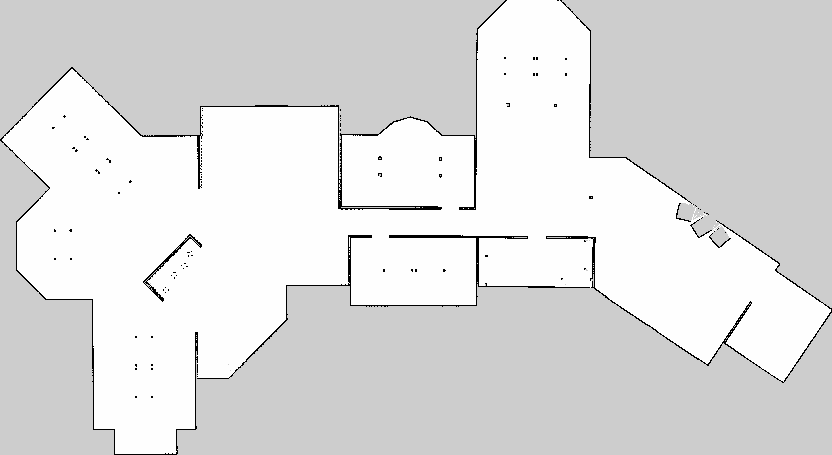
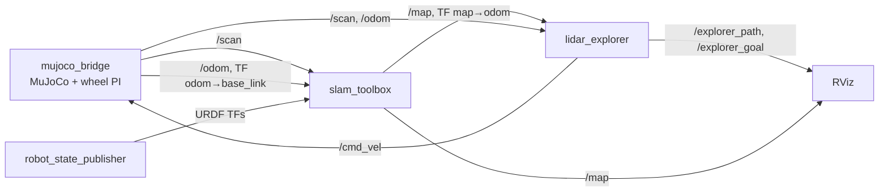
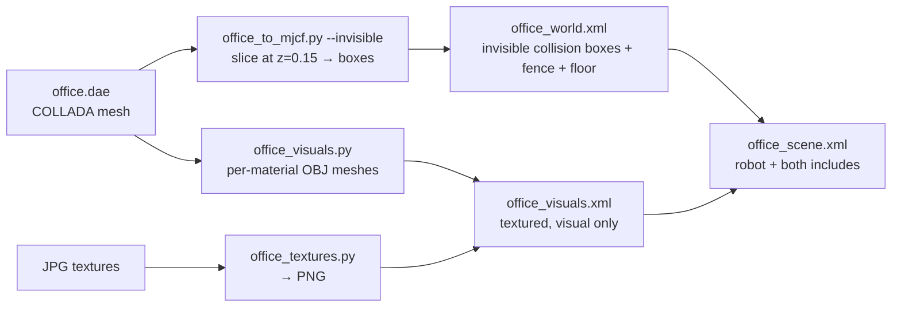
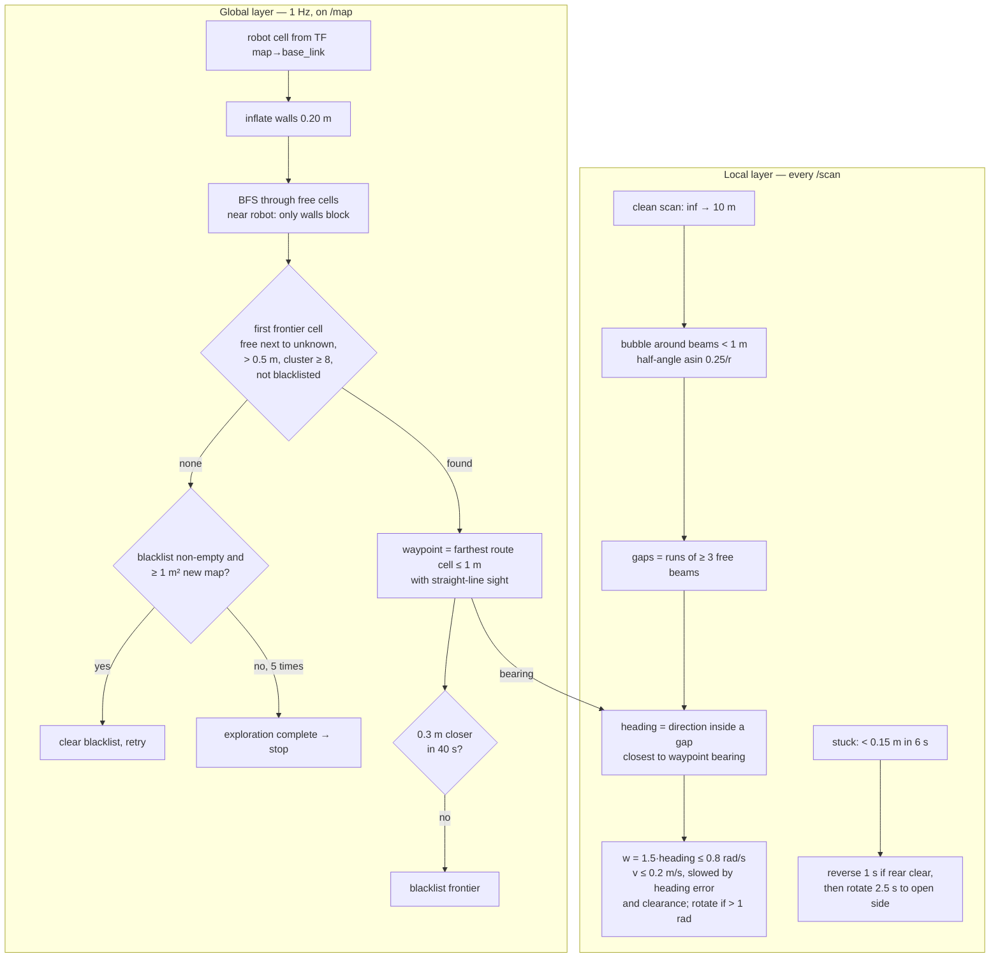
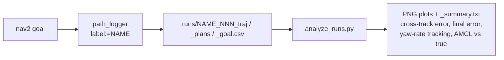

# AMR

Differential-drive AMR simulated in MuJoCo, ROS 2 Humble, C++. Robot model
(meshes/URDF/world) reused from [`Ros-AMR-Mobile-Robot`](../Ros-AMR-Mobile-Robot),
rebuilt from scratch in C++ instead of the original's Python + Gazebo stack.

The robot can explore an unknown building on its own from lidar alone, while
`slam_toolbox` builds the map. Explored office map:



The `amr_bot` package has four executables:

| Executable | What it does |
|---|---|
| `mujoco_bridge` | Physics (500 Hz), wheel-speed PI, publishes `/odom`, `/scan`, `/joint_states`, TF `odom→base_link`; optional MuJoCo viewer |
| `lidar_explorer` | Autonomous exploration: frontier selection on the live SLAM map + lidar gap steering → `/cmd_vel` |
| `path_logger` | Logs planned vs actual path per nav2 goal to CSV (`runs/`) |
| `obstacle_avoider` | Lidar emergency stop on `/cmd_vel_safe` (standalone, not wired in) |



## Prerequisites

- Docker, with an X server (`$DISPLAY` set) for RViz / the MuJoCo viewer.
- The `supermarketbot:humble` image (ROS 2 Humble + nav2 + slam_toolbox +
  the `mujoco` pip wheel), built from `../Ros-AMR-Mobile-Robot/dockerfile`.
  Host OS itself doesn't need to be 22.04 — everything runs in the container.

## One-time container setup

```bash
xhost +local:docker
docker start -ai amr
```
X11 permission grant for the container to draw on your host display.
**Does not persist across host logins** — re-run this if RViz/the MuJoCo
window later fails with `No protocol specified`.

```bash
docker run -it --name amr \
  --net=host \
  -e DISPLAY=$DISPLAY \
  -v /tmp/.X11-unix:/tmp/.X11-unix \
  -v ~/projects/AMR_Practice_project:/ros2_ws \
  -v ~/projects/Ros-AMR-Mobile-Robot:/reference:ro \
  --entrypoint bash \
  supermarketbot:humble
```
- `--net=host` — ROS 2 DDS discovery is multicast-based; bridge networks break it.
- `--entrypoint bash` — the image's default entrypoint sources
  `/ros2_ws/install/setup.bash`, which doesn't exist yet on a fresh mount
  and aborts the whole chain. Override it and source manually instead.
- No `--gpus`: everything (RViz, the MuJoCo viewer) runs via Mesa software
  rendering — see the `LIBGL_ALWAYS_SOFTWARE` note below.

Once inside, install the extra dev packages the base image doesn't ship
(**container-local only — repeat this after any `docker rm`/fresh `docker run`,
or bake it into a Dockerfile if that gets old**):
```bash
apt-get update && apt-get install -y libglfw3-dev libgl1-mesa-dev
```

## Recurring session commands

```bash
docker start -ai amr        # resume the container
docker exec -it amr bash
```

Every shell (each `exec`/`start`) needs sourcing before any `ros2`/`colcon` command:
```bash
source /opt/ros/humble/setup.bash
source /ros2_ws/install/setup.bash
```

Software rendering is required for the MuJoCo GLFW viewer (no `/dev/dri` GPU
passthrough is configured); export it once per shell that runs `mujoco_bridge`,
or prefix the command:
```bash
export LIBGL_ALWAYS_SOFTWARE=1
```

## Build

```bash
cd /ros2_ws
colcon build --packages-select amr_bot
source install/setup.bash
```
(`--packages-select`, not `--package-select` — easy typo.) A real rebuild takes
several seconds; if colcon finishes in ~0.1 s after you changed a `.cpp`, nothing
was recompiled — save the file and build again. A new executable also needs its own
`install(TARGETS …)` line in `CMakeLists.txt`, or `ros2 run` says `No executable found`.

On the host, files created inside the container land owned by `root`; fix
once per session if VSCode/host tools can't edit them:
```bash
sudo chown -R $USER:$USER ~/projects/AMR_Practice_project
```

## Worlds

`mujoco_bridge` takes the scene file as the `scene` parameter:

| World | Scene file | Notes |
|---|---|---|
| Supermarket (default) | `models/world/supermarket_scene.xml` | original world |
| Office | `models/world/office_scene.xml` | Clearpath `cpr_office_gazebo` (BSD), converted to MuJoCo — see `models/office/README.md` |

```bash
LIBGL_ALWAYS_SOFTWARE=1 ros2 run amr_bot mujoco_bridge \
  --ros-args -p scene:=/ros2_ws/src/amr_bot/models/world/office_scene.xml
```

The office conversion is scripted (`src/amr_bot/scripts/`):

Collision uses invisible boxes (meshes would collide as convex hulls and fill the
doorways); the textured meshes are visual only, but lidar rays still hit them, so the
scan sees the real geometry. The robot's include must stay first so its
`<compiler>`/`<option>` (radians, 0.002 s) win.

## Autonomous exploration (no prior map)

Four terminals (each sourced), **no nav2 and no teleop** (teleop would fight the
explorer on `/cmd_vel`):
```bash
LIBGL_ALWAYS_SOFTWARE=1 ros2 run amr_bot mujoco_bridge --ros-args -p scene:=/ros2_ws/src/amr_bot/models/world/office_scene.xml
ros2 launch amr_bot rsp.launch.py
ros2 run slam_toolbox async_slam_toolbox_node --ros-args --params-file /ros2_ws/src/amr_bot/config/async_slam_toolbox_cfg.yaml
ros2 run amr_bot lidar_explorer
```
It logs `mapped area: … m^2` every 10 s and stops by itself with
`exploration complete`. Then save the map:
```bash
ros2 run nav2_map_server map_saver_cli -f /ros2_ws/src/amr_bot/maps/office
```
RViz: Fixed Frame `map`; `Map` on `/map` (Durability Transient Local); `Path` on
`/explorer_path` (set Color 255,0,0 — the travelled path); `PointStamped` on
`/explorer_goal` (current waypoint); `LaserScan`, `RobotModel`.

### How `lidar_explorer` works

Two layers. The global layer decides *where* to go from the map being built; the
local layer decides *how* to drive there from the current scan.



- A **frontier** is a free cell next to unknown space — the edge of what has been seen.
  Going to the nearest reachable one, again and again, covers every reachable room.
- Before the first map arrives, the local layer steers to the **range-weighted (r²)
  mean angle inside the widest, deepest gap** — "go where the lidar sees farthest",
  restricted to one opening so two openings can't average into a wall.
- Why not purely reactive: that version (with and without a visit-memory bonus) kept
  looping in the main hall — a scan alone can't tell that a door leads somewhere new.

All thresholds are ROS parameters, e.g. `ros2 run amr_bot lidar_explorer --ros-args -p v_max:=0.15 -p goal_timeout_s:=60.0`.
Main ones: `v_max` 0.2, `w_max` 0.8, `kp_heading` 1.5, `obstacle_dist` 1.0, `margin` 0.10,
`stop_dist` 0.30, `plan_inflation` 0.20, `waypoint_lookahead` 1.0, `min_frontier_cells` 8,
`goal_timeout_s` 40, `progress_dist` 0.3, `backup_s` 1.0.

SLAM config tuned for this: `max_laser_range: 10.0` (the lidar's real range),
`map_update_interval: 2.0` (keeps the map close behind the robot). Fan-shaped streaks
in the live map are normal: 1° beams are ~17 cm apart at 10 m, wider than a 5 cm cell.

## Navigating on a saved map (nav2)

**1. Bridge + URDF TFs** as above (`mujoco_bridge`, `rsp.launch.py`).

**2. nav2:**
```bash
ros2 launch nav2_bringup bringup_launch.py \
  use_sim_time:=false \
  map:=/ros2_ws/src/amr_bot/maps/market.yaml \
  params_file:=/ros2_ws/src/amr_bot/config/nav2_params.yaml
```

**3. Localize, then send a goal.** AMCL publishes no `map`→`odom` transform until it
has an initial pose (`set_initial_pose: true` in the params sets it at the origin, where
the robot spawns). To set it by hand: RViz **2D Pose Estimate** (Fixed Frame must be
`map`, click on the robot), or:
```bash
ros2 topic pub --once /initialpose geometry_msgs/msg/PoseWithCovarianceStamped \
  "{header: {frame_id: map}, pose: {pose: {position: {x: 0.0, y: 0.0, z: 0.0}, orientation: {w: 1.0}}, covariance: [0.25,0,0,0,0,0, 0,0.25,0,0,0,0, 0,0,0,0,0,0, 0,0,0,0,0,0, 0,0,0,0,0,0, 0,0,0,0,0,0.0685]}}"
```
Check it took (ground truth is `/odom`, which should agree with AMCL within a few cm):
```bash
ros2 topic echo /amcl_pose --once --field pose.pose.position
ros2 run tf2_ros tf2_echo map odom
```
Goal: RViz **2D Goal Pose**, or repeatable from the CLI (x, y in `map`, yaw in rad):
```bash
/ros2_ws/src/amr_bot/scripts/send_goal.sh 1.74302 3.30992 -0.06743
```

Controller: `RotationShimController` (rotates in place toward the path first) wrapping
DWB. Goal tolerance 0.10 m / 0.10 rad. Costmaps: `robot_radius` 0.15,
`inflation_radius` 0.30, `cost_scaling_factor` 5.0. Nav2 reads params only at startup —
relaunch after editing.

**Build a map by hand instead** (teleop + SLAM, no explorer):
```bash
ros2 run teleop_twist_keyboard teleop_twist_keyboard
ros2 run slam_toolbox async_slam_toolbox_node \
  --ros-args --params-file /ros2_ws/src/amr_bot/config/async_slam_toolbox_cfg.yaml
```

## Measuring path following


```bash
ros2 run amr_bot path_logger --ros-args -p label:=afterctrl   # one CSV set per goal into runs/
python3 /ros2_ws/src/amr_bot/scripts/analyze_runs.py runs/afterctrl/afterctrl_001 \
  --map /ros2_ws/src/amr_bot/maps/market.yaml --compare runs/baselne/baseline_007
```
Run it in the container (matplotlib is there, not on the host). `runs/` is gitignored
and root-owned: `sudo chown -R $USER:$USER runs` on the host. Set a correct AMCL pose
before recording anything.

## Wheel control (in `mujoco_bridge`)

`/cmd_vel` → wheel speed references (wheel radius 0.035 m, separation 0.205 m) → PI per
wheel on the simulated motor torque, using the sim time step, with anti-windup.
Tunable live:
```bash
ros2 param set /mujoco_bridge wheel_kp 0.08
ros2 param set /mujoco_bridge wheel_ki 0.5
ros2 param set /mujoco_bridge wheel_tau_max 0.15
```
The caster has `priority="1"` in the scene so its low friction wins the contact — before
that, MuJoCo's per-component max made the caster as grippy as the floor, which dragged
every turn. `/odom` twist is in the body frame.

## Other nodes

**`obstacle_avoider`** — if the nearest return in the ±20° forward cone (scan indices
160–200) is closer than 0.3 m, publishes a zero `Twist` on `/cmd_vel_safe`. Standalone,
not merged into `/cmd_vel` (needs `twist_mux`).
```bash
ros2 run amr_bot obstacle_avoider
```

**Native MuJoCo viewer** — opens as part of `mujoco_bridge`, mirrors the same live
simulation. Left-drag orbit, right-drag pan, scroll zoom.

## Debugging one link in the pipeline

```bash
ros2 node list
ros2 topic list
ros2 topic echo /odom --once
ros2 topic echo /scan --once
ros2 run tf2_ros tf2_echo odom base_link
ros2 run tf2_ros tf2_echo map base_link        # SLAM/AMCL running
ros2 lifecycle get /amcl                       # expect: active [3]
```
Is the binary the one you just built? Check a log string from the new code, e.g.
`strings install/amr_bot/lib/amr_bot/lidar_explorer | grep -c reversing`.

Nav2 prints nothing after `process started`, or nodes won't configure: a previous nav2 is
probably still running.
```bash
pgrep -fa nav2_bringup                        # should show exactly one launch
ros2 node list | sort | uniq -d               # must print nothing (duplicate node names)
pkill -9 -f component_container_isolated     # the container ignores SIGINT/SIGTERM, so -9 every time
pkill -f "ros2 launch nav2_bringup"
```
Only one `mujoco_bridge` at a time — two on one ROS domain mix their messages.

## Notes

- Robot: wheel radius 0.035 m, wheel separation 0.205 m, mass 1.4 kg; lidar 360 beams at
  1°, index 0 = behind, index 180 = straight ahead, 0.1–10 m, no return = `inf`.
- Default scene path is hardcoded in `mujoco_bridge.cpp` (override with `scene:=`), not
  yet via `ament_index_cpp::get_package_share_directory`.
- A saved map only matches the world it was built in — re-run SLAM and re-save whenever
  the world changes. **Currently `maps/market.*` holds the office map** (saved with the
  wrong name); rename it to `office.*` and restore the supermarket map from git
  (`git checkout 31d6d16 -- src/amr_bot/maps/market.pgm src/amr_bot/maps/market.yaml`).

## Known issues

- RViz prints `[ERROR] ... indexed_8bit_image ... active samplers with a different type refer
  to the same texture image unit` when the `Map` display is created, and the map can render
  blank (software rendering, no `/dev/dri`). Cosmetic; nav2 is unaffected.
- A 2D Pose Estimate clicked on a blank viewport can put AMCL kilometres off. Re-set the
  pose and verify with `/amcl_pose`.
- See `PROCESS.md` (gitignored, local only) for the full build log, every bug hit and why,
  and the experiment results.
